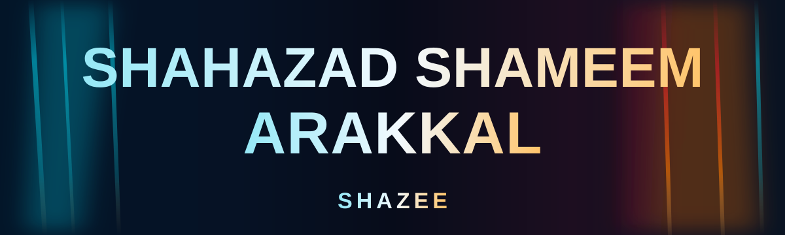
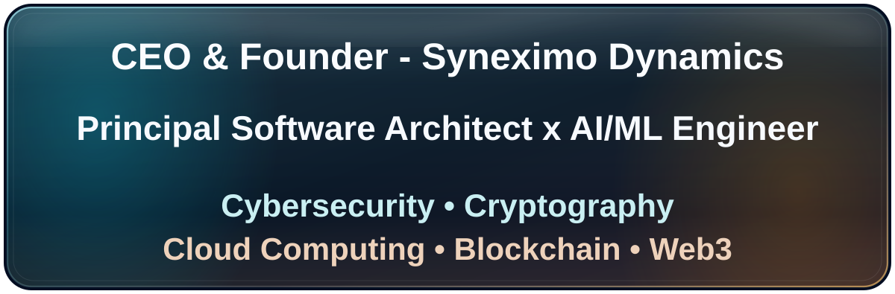

<!-- Personal GitHub profile: Shahazad Shameem Arakkal (Shazee) -->

<div align="center">





<br />

  

 

[](https://github.com/legacyofshahz)

[](https://github.com/legacyofshahz/scaffold-hbar-sovereign-settlement)

  

</div>

---

## About

I’m **Shahazad Shameem Arakkal (Shazee)**, a founder, creator and systems architect working at the intersection of **software engineering, AI orchestration, cloud systems and programmable infrastructure**.

My education includes a **Bachelor of Computer Applications (BCA)** and **Higher Secondary education in Computer Science**. I also bring **10+ years of corporate experience in Business Development Management**, spanning sales, marketing and stakeholder engagement. I approach engineering through a product lens: clear authority boundaries, practical usability, predictable operations and independently checkable outcomes.

**Engineering focus:** Cybersecurity · Cryptography · Cloud Computing · Blockchain · Web3, alongside AI/ML orchestration and human-centered software engineering.

<details>
<summary><b>Explore my engineering focus areas</b></summary>

| Focus domain | Engineering direction |
| :--- | :--- |
| **AI orchestration & automation** | Multi-model routing, governed agent delegation, evaluation, deterministic preflight and failure recovery |
| **Cybersecurity & cryptographic trust** | Threat modeling, least-privilege authorization, signed intents, replay protection and evidence integrity |
| **Cloud & DevSecOps** | Google Cloud architecture, identity and access boundaries, secret handling, CI verification and operational resilience |
| **Web3 & distributed systems** | Hedera smart contracts, oracle freshness checks, testnet transaction verification and consensus evidence |
| **Human-centered product engineering** | Usable control interfaces, observability, stakeholder alignment and independently checkable system behavior |

</details>

<details>
<summary><b>Engineering philosophy · Time, Trust, Truth</b></summary>

**Time · Trust · Truth** shapes how I prioritize engineering decisions.

| Principle | Operational interpretation |
| :--- | :--- |
| **Time** | Protect human attention, reuse verified work and minimize unnecessary execution |
| **Trust** | Respect consent, authority boundaries, least privilege and recoverable automation |
| **Truth** | Separate assumptions from observations, testing from deployment and claims from verified outcomes |

**Working standard:** Purpose → Constraints → Implementation → Test → Independent evidence → Human-reviewed outcome.

I prefer smaller, inspectable systems that can be corrected to impressive-looking systems whose claims cannot be checked.

</details>

<details>
<summary><b>Education & credentials</b></summary>

**Education:** Bachelor of Computer Applications (BCA) · Higher Secondary, Computer Science.

 

Only independently attributable certifications will be listed here.

</details>

*These are areas of engineering work and continuing development, not a claim of certifications, professional security assessments or production qualification.*

**Open to:** engineering collaboration, open-source contributions and technical research.

---

## Tech Stack

<div align="center">


</div>

| Domain | Tools and technologies |
| :--- | :--- |
| **Languages** | Python, TypeScript, JavaScript, Solidity, PowerShell |
| **Frontend** | React, Next.js, web interfaces |
| **Backend & Data** | Node.js, REST interfaces, SQLite, smart contracts |
| **Cloud & Engineering** | Google Cloud, GitHub Actions, Docker, Terraform, Linux, Windows and WSL |
| **Systems & Security** | AI orchestration, cybersecurity, identity and authority design, deterministic preflight, verification workflows |

*This table describes technologies worked with or explored, not independently tested proficiency levels.*

---

## AI / ML Expertise

| Domain | Focus | Details |
| :--- | :--- | :--- |
| **Multi-model orchestration** | Systems architecture | Provider routing, delegated agent execution and bounded authority |
| **Agentic automation** | Design & integration | Human approval boundaries, failure recovery and reproducible operations |
| **Evaluation & reasoning** | Methodology | Evidence collection, reproducibility, qualification criteria and uncertainty tracking |
| **Machine learning** | Active exploration | TensorFlow and applied ML workflows under evaluation |

*No model-training performance, benchmark score or deployed AI capability is claimed without public supporting evidence.*

---

## Systems Architecture

I explore architectures that separate **human intent, delegated authority, automated execution and independently observed results**. The separation matters more than how many models or services are connected.

| Boundary | Engineering concern | Qualification question |
| :--- | :--- | :--- |
| **Human intent** | Objectives, approval scope and accountable ownership | Who can authorize this action? |
| **Policy & trust** | Identity, permissions, constraints and expiry | Is this action permitted *now*? |
| **Intelligence & orchestration** | Model selection, reasoning, tool delegation and controlled retries | Can the proposed action be justified and bounded? |
| **Execution** | Deterministic interfaces, idempotency and failure containment | Did the intended operation actually happen? |
| **Evidence & recovery** | Logs, independent observation and safe reconciliation | Can the outcome be independently checked or safely recovered? |

<details>
<summary><b>View the reference execution flow</b></summary>

```text
Human objective
      |
      v
Authority and policy gate
      |
      v
Reasoning and delegated planning
      |
      v
Bounded execution
      |
      v
Independent verification and evidence
      |
      +----> Recovery / review when checks fail
      |
      v
Human-reviewed outcome
```

This is a reference design pattern, not a claim that every layer is already deployed as one production system.

</details>

---

## Cybersecurity & Trust Engineering


My cybersecurity focus is **secure-by-design engineering**: reducing unauthorized actions, protecting sensitive execution paths and making security-relevant decisions auditable.

| Security domain | Approach | Evidence boundary |
| :--- | :--- | :--- |
| **Identity & access** | Least privilege, scoped delegation, explicit authorization and revocation design | Architecture and policy controls |
| **Cryptographic authorization** | Signed intents, integrity commitments and replay-resistant operations | Public Solidity implementation in the [Hedera scaffold](https://github.com/legacyofshahz/scaffold-hbar-sovereign-settlement) |
| **Secure execution** | Expiry checks, input validation, oracle freshness checks and fail-closed behavior | Testnet-first project documentation and tests |
| **Cloud & application security** | Secret isolation, CI controls, dependency hygiene and threat-model-driven review | Ongoing engineering focus |
| **Defensive research** | Failure analysis, attack-surface reduction and reproducible security testing | Exploration, not an accredited security assessment |

**Trust principle:** A signed request is not automatically a safe request; authorization, context, freshness and post-execution evidence all matter.

This section describes engineering work and research interests. It does not assert a professional cybersecurity certification, completed third-party audit or production security guarantee.

---

## Featured Projects

<details open>
<summary><b>Hedera HBAR Settlement Scaffold | Hedera Testnet</b></summary>

A public, testnet-first engineering template for policy-constrained HBAR settlements. It combines signed execution authorization, oracle freshness safeguards, independent transaction observation and integrity anchoring.

| Dimension | Publicly documented implementation |
| :--- | :--- |
| **Stack** | Solidity, Hardhat, Next.js, TypeScript, Hedera EVM, Supra oracle |
| **Scale** | Reusable scaffold; no production throughput claim |
| **Performance** | No independently established latency or throughput benchmark |
| **Security** | EIP-712 authorization, replay protection, deadlines, bounded price and oracle freshness checks |
| **Evidence** | Mirror Node result verification and Hedera Consensus Service (HCS) integrity record |
| **Impact** | Reference implementation for evidence-oriented settlement workflows |
| **Repository** | [View source](https://github.com/legacyofshahz/scaffold-hbar-sovereign-settlement) |

The repository README documents a Hedera testnet settlement transaction and an HCS evidence record. These are presented as **repository-reported testnet evidence**, not proof of mainnet qualification or live commercial settlement.

[Repository documentation and evidence](https://github.com/legacyofshahz/scaffold-hbar-sovereign-settlement#verified-hedera-testnet-evidence)

</details>

*Featured projects are limited to public, attributable work.*

---

## Validation & Evidence

I distinguish **implementation**, **automated testing**, **observed execution** and **demonstrated real-world outcomes**. Each requires different evidence.

| Evidence level | Publicly inspectable source | What it establishes |
| :--- | :--- | :--- |
| **Source implementation** | [Scaffold-HBAR repository](https://github.com/legacyofshahz/scaffold-hbar-sovereign-settlement) | Published design and source code, not operational readiness |
| **Automated qualification** | [GitHub Actions workflow history](https://github.com/legacyofshahz/scaffold-hbar-sovereign-settlement/actions) | Inspectable test and CI records; check individual run conclusions |
| **Testnet execution** | [Mirror Node settlement record](https://testnet.mirrornode.hedera.com/api/v1/contracts/results/0x900e24a5817b928a9f2f92aceab6ae0c4f0cbe59fb1927ba4ce7c5fee92877c9) | A specific Hedera testnet transaction reference |
| **Integrity anchoring** | [HCS message record](https://testnet.mirrornode.hedera.com/api/v1/topics/0.0.10639224/messages/1) | A separately inspectable testnet consensus-message reference |
| **Mainnet / commercial outcome** | No qualifying public receipt presented | Not established |

<details>
<summary><b>How I evaluate an engineering claim</b></summary>

1. Define the exact claim and a falsifiable acceptance criterion.
2. Identify what source, test, transaction or independent observer can prove it.
3. Record the observed result with its environment and limitations.
4. Separate passing checks from deployment, adoption, safety and real-world impact.

</details>

*Published transaction references are sourced from the project's README; they should not be read as a claim of production qualification or commercial settlement.*

---

## Experience

**Corporate Experience · 10+ Years**  
Business Development Management

- Business development, sales and marketing with a focus on customer needs and stakeholder relationships.
- Bring commercial strategy, organizational coordination and practical delivery priorities into technical product decisions.

**Founder & Systems Architect**  
Independent engineering and venture initiatives

- Design authority-conscious AI, automation and cloud architecture.
- Translate technical capabilities into human-centered products and operational workflows.

**Focus areas:** Product architecture · Systems design · Cloud engineering · Technical strategy · AI integration

*Specific employment dates and employers are not published here without an approved professional record.*

---

## Achievements

| Recognition | Public evidence |
| :--- | :--- |
| **Public Hedera engineering template** | [Scaffold-HBAR settlement repository](https://github.com/legacyofshahz/scaffold-hbar-sovereign-settlement) |
| **Documented testnet proof** | [Settlement and HCS evidence references](https://github.com/legacyofshahz/scaffold-hbar-sovereign-settlement#verified-hedera-testnet-evidence) |

*Milestones refer to published project documentation. Awards, paid bounties, and commercial deployment are not implied.*

---

## GitHub Analytics

<div align="center">


</div>

*Third-party widgets display GitHub-derived statistics and may be temporarily unavailable or rate-limited. Language charts are based on repository contents, not personal proficiency.*

<details>
<summary><b>GitHub trophies (external widget)</b></summary>

<div align="center">


</div>

*The widget is external and may not always load.*

</details>

---

## Contribution Activity

<div align="center">


</div>

[Explore my GitHub contribution history](https://github.com/legacyofshahz). A contribution-snake animation is not currently published.

---

## Current Focus

```yaml
learning:
  - applied ML evaluation and reliable multi-model reasoning
  - cybersecurity research and application threat modeling
  - distributed-system failure modes and cryptographic assurance
building:
  - human-governed AI orchestration and bounded automation
  - cloud workflows with least-privilege and recovery controls
  - reproducible testnet verification and evidence pipelines
exploring:
  - secure-by-design Web3 and smart-contract architectures
  - defensive security research and open-source contributions
open_to:
  - open-source engineering and security collaboration
  - applied AI research and trustworthy systems partnerships
```

---

## Connect

**GitHub:** [legacyofshahz](https://github.com/legacyofshahz)  
**Featured work:** [Hedera HBAR Settlement Scaffold](https://github.com/legacyofshahz/scaffold-hbar-sovereign-settlement)

Contact through my GitHub profile.

**Coding profiles:** Other coding-platform profiles will appear when their ownership is confirmed.

---

## Footer

<div align="center">

**Build with intent. Verify with evidence.**


</div>
